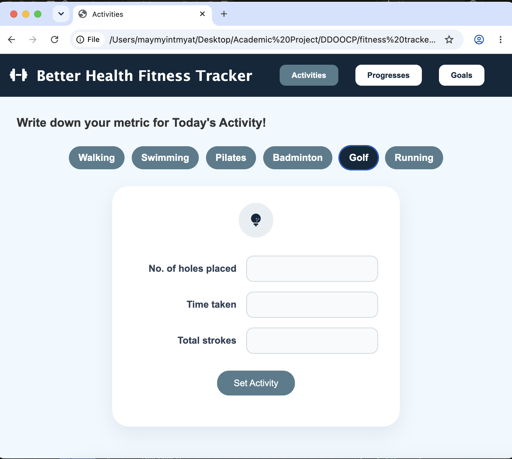
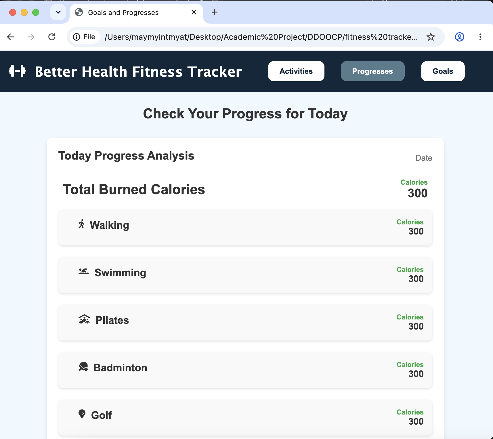
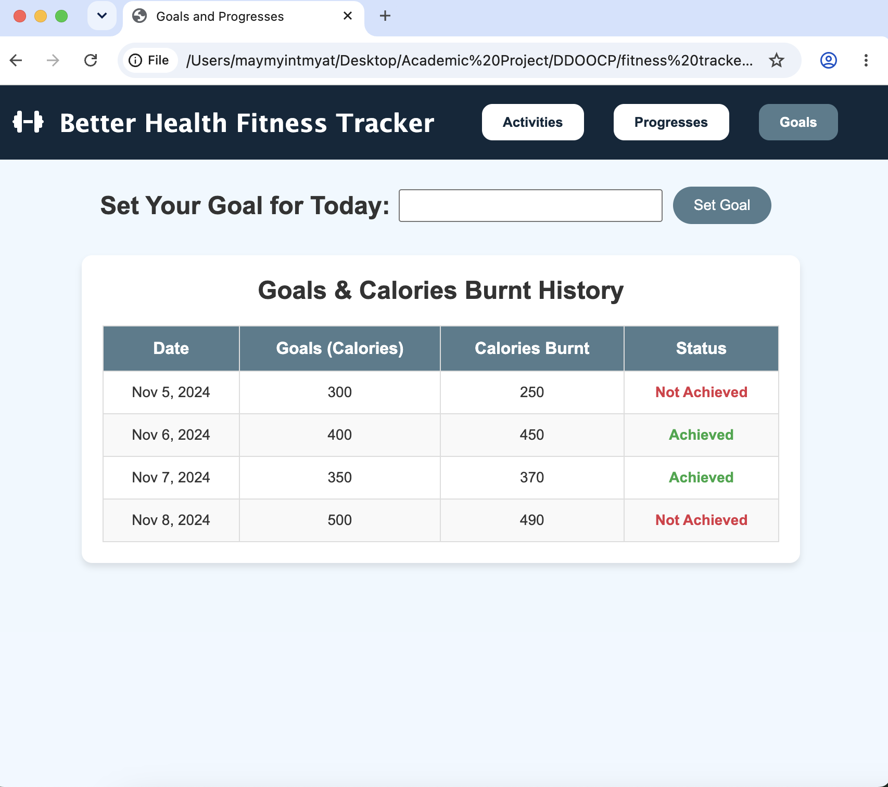

# Fitness Tracker Website

### ASP.NET Web Application | Academic Project

## About the Project

Fitness Tracker is a web application I developed as an academic project. It helps users track their physical activities, set fitness goals, and monitor their progress.

Through this project, I gained practical experience in C# programming, ASP.NET web development, database integration, and working with SQL queries.

## Technologies Used

- **C#** – Backend programming
- **ASP.NET Web Forms** – Web application development
- **SQL Server LocalDB** – Database management
- **HTML & CSS** – Website structure and styling
- **Visual Studio** – Development environment

## Key Features

- User registration and login
- Fitness goal setting
- Physical activity tracking
- Calorie calculation and tracking
- Fitness progress monitoring
- Database integration for storing user activities and goals

## Project Screenshots

### Activity Tracking

### Fitness Progress

### Goal Tracking

## How to Run

1. Open the `.sln` file in a compatible version of Visual Studio on Windows.
2. Ensure ASP.NET Web Forms and SQL Server LocalDB are installed.
3. Configure the database connection in `database.cs`.
4. Ensure the required SQL Server database is available.
5. Build and run the application through Visual Studio.

## Project Limitations

This is an academic project developed for learning purposes. Authentication currently uses plaintext password handling and should be upgraded to secure password hashing before any real-world deployment.

## Project Information

**Developer:** May Myint Myat  
**Project Type:** Academic Project  
**Technology:** ASP.NET, C#, SQL Server

---

*Developed as part of my academic studies.*
